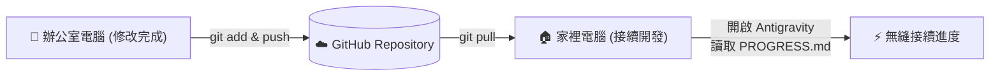

# 專案進度與待辦清單 (Project Progress & TODO)

> **最後更新時間**：2026-11-05  
> **專案儲存庫**：`https://github.com/toby55113/my-tool.git` (Branch: `main`)  
> **適用情境**：跨電腦（辦公室/家裡）切換時，供使用者與 Antigravity AI 快速掌握工作進度與上下文。

---

## 📌 跨環境快速接續指令 (For Antigravity AI)
> **當您在家裡或新設備開啟 Antigravity 新對話時，請直接複製以下這句話傳給 AI：**
> 
> *「你好，請先閱讀專案根目錄下的 `PROGRESS.md`，並告訴我目前各模組的最新進度與待辦事項，我們繼續進行下一步。」*

---

## 一、專案三大核心板塊總覽

本專案 `my-tool` 整合了三大工作領域：
1. **水利工程與水理計算工具**（Django 曼寧公式計算系統、管線資料統計清洗）
2. **國土署污水下水道定期考核業務**（楠梓BOT案定考簡報、委員意見回復彙整、營運指標分析）
3. **環工技師證照備考庫**（102~113年歷屆考題整理、考前高頻重點分析、空白模擬練習卷）

---

## 二、目前進度與已完成項目 (Completed)

### 1. 水理計算與管線分析工具 (Hydraulic Tools)
- [x] **Django 曼寧公式計算平台** (`calculator/`, `config/`, `manage.py`)
  - 建立基於 Django 的 Web 介面。
  - 支援圓管、矩形渠、梯形渠之水理參數計算（流量 $Q$、流速 $V$、水深 $y$、粗糙係數 $n$、坡降 $S$）。
- [x] **管線資料統計分析腳本** (`analyze_pipes.py`)
  - 讀取 `管線表.xlsx`，依照管徑、管種、坡度等維度進行數據彙整。
  - 自動產出統計圖表與報表 `統計結果.xlsx`。
- [x] **環境依賴與規範** (`requirements.txt`, `.agents/rules/python-venv.md`)
  - 規範 Windows/Mac 虛擬環境 (`venv`) 獨立管理與執行原則。

---

### 2. 國土署污水下水道考核作業 (Sewerage Assessment - 楠梓廠)
- [x] **114 下半年 / 115 上半年定期考核資料盤點** (`國土署考核/`)
  - 彙整查考簡報、委員意見紀錄單、改善彙整表、開會通知與相關佐證附件。
- [x] **前次考核意見回復修訂與精進** (`參、前次考核意見回復.pptx`, `adjust_items.txt`)
  - **因果關係分析補強**：針對委員意見，補強「進流異常/油脂 → 初沉池 → 生物池 DO/MLSS/SRT → 二沉池 RAS/排泥 → 出流水質」之聯動因果。
  - **五大營運風險指標建立**：增加排泥（動態 SRT 9.5~10.5 天）、調整曝氣（DO $\ge 1.5$ mg/L）、調整初沉池池數（完成 PP-2302 泵重置）、強化浮渣清除、異常水質管網巡查吸油棉機制。
  - **操作成效數據化**：補充 115 上半年氨氮（平均 1.22 mg/L，去除率 95%）、總氮（平均 15.2 mg/L）之放流合規數據。

---

### 3. 環工技師證照備考講義與題庫 (Environmental Engineering PE Exam)
- [x] **歷屆考古題全面歸納 (102~113 年)** (`工程師考古-20261103T022048Z-1-001/`)
  - 水處理工程、空氣污染防制、廢棄物工程、環境化學與環境微生物、土壤與地下水污染、環境規劃與管理等全考科題目整理。
- [x] **各科考題整理與模擬卷生成** (`工程師_歷屆PDF題/`)
  - 產出各科整編版 PDF 題庫與無解答空白模擬練習卷。
- [x] **考前高頻重點與題解分析**
  - `工程師_考前重點與高頻題分析.md`：核心公式、高頻出題單元、考試答題策略。
  - `工程師_歷年考題與參考解答.md`：重點題型剖析與詳解對照。

---

## 三、待辦事項與後續規劃 (TODO List)

### 🔴 高優先級 (Immediate / High Priority)
- [ ] **國土署考核簡報最終校對與整合**：
  - [ ] 確認 `adjust_items.txt` 中修改內容已完整同步至最終定稿簡報 PPTX。
  - [ ] 核對簡報頁碼索引（如 P.16、P.63~66、P.96、P.100）是否與最新簡報一致。
  - [ ] 產出最終考核答辯簡報完整版 PDF/PPTX 供正式報告使用。
- [ ] **GitHub 遠端儲存庫同步檢查**：
  - [ ] 定期檢查 `git status`，將 `國土署考核/` 與最新修訂文件推送至 GitHub。
  - [ ] 確認 GitHub 儲存庫為 **Private**，保障敏感工程營運數據安全。

### 🟡 中優先級 (Medium Priority)
- [ ] **曼寧公式計算平台功能延伸**：
  - [ ] 增加常用管徑規格快速選單（如 RCP、HDPE、不鏽鋼管）。
  - [ ] 增加臨界流深與臨界坡度（Critical Depth & Slope）計算功能。
  - [ ] 優化前端視覺化圖表呈現（水力坡降線與截面充水高度繪圖）。
- [ ] **環工技師備考進階演練**：
  - [ ] 完成 110~113 年最新試題的實戰空白卷筆試演練。
  - [ ] 針對失分高頻題型（如硝化脫硝水理動力學、活性污泥動力參數推導）建立手寫推導筆記。

### 🟢 低優先級 / 長期維護 (Low Priority)
- [ ] 評估是否將考核與管網計算工具包裝成 Docker 容器或輕量內部部署工具。

---

## 四、主要檔案與目錄對照表 (File Map)

| 路徑 / 檔案 | 類型 | 說明 |
| :--- | :--- | :--- |
| `calculator/`, `config/`, `manage.py` | Web 程式 | Django 曼寧公式水理計算網站 |
| `analyze_pipes.py` | Python 腳本 | 管線統計數據清洗與 Excel 產出工具 |
| `管線表.xlsx` / `統計結果.xlsx` | 試算表 | 輸入管網原始資料 / 統計分析結果 |
| `國土署考核/` | 業務資料夾 | 114下與115上國土署定期考核簡報、回覆意見、附件 |
| `adjust_items.txt` | 紀錄檔 | 國土署定考意見回覆對照與簡報修改摘要 |
| `參、前次考核意見回復.pptx` | 簡報檔 | 定期考核針對前期委員意見之具體答覆 PPT |
| `工程師_考前重點與高頻題分析.md` | 筆記講義 | 環工技師考前高頻核心觀念與題型策略整理 |
| `工程師_歷年考題與參考解答.md` | 考題詳解 | 歷屆考題解答與題型對照 |
| `工程師_歷屆PDF題/` | 資料夾 | 整理後之各考科 PDF 與無解答空白練習題卷 |
| `requirements.txt` | 設定檔 | Python 套件依賴清單 |
| `PROGRESS.md` | 進度清單 | 本專案整體進度、待辦清單與跨機接續指南 |

---

## 五、跨環境切換同步指南 (Workflow)



1. **下班離開封裝**：
   ```powershell
   git status
   git add .
   git commit -m "更新進度與檔案"
   git push origin main
   ```
2. **到家接續**：
   ```powershell
   git pull origin main
   ```
   *若家裡電腦初次使用，請先建置虛擬環境：*
   ```powershell
   python -m venv venv
   .\venv\Scripts\pip.exe install -r requirements.txt
   ```
3. **在 Antigravity 喚醒 AI**：
   直接傳送：「*請閱讀 `PROGRESS.md`，接續上次進度*」。
