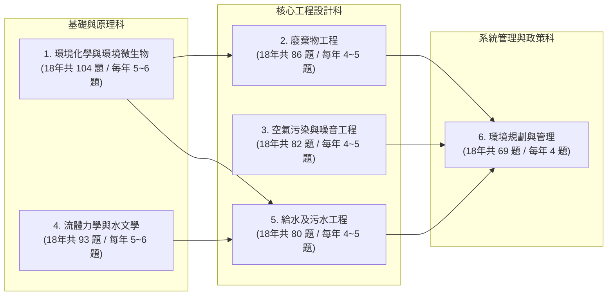

# 環工技師考古題（97–114年）趨勢分析與考前重點指南

> [!IMPORTANT]
> **資料範疇與統計基礎**：本報告完整解析專案資料夾內 **民國 97 年至 114 年（共 18 個年度、6 大考科、108 份試卷、合計 514 道申論與計算大題）** 之環工技師高考試題，結合「18 年長週期出題頻率」與「近 5 年（110–114 年）最新命題轉向」，將各科考點分為 **★★★ 必考核心（出現率 $\ge 70\%$）**、**★★☆ 重點常考（出現率 $45\% \sim 69\%$）** 與 **★☆☆ 政策／新興熱點（近 3–5 年密集出題）**。

---

## 壹、 六大考科 18 年命題結構總覽

| 考科名稱 | 18年總題數 | 近5年(110-114)題數 | 計算題佔比(約) | 申論/設計題佔比(約) | 近 5 年最顯著命題趨勢 |
| :--- | :---: | :---: | :---: | :---: | :--- |
| **1. 環境化學與環境微生物** | 104 | 29 | 50% | 50% | 碳酸系統/酸鹼中和計算必考；微生代名詞轉向「低碳氮比除氮(Anammox)、NGS非培養鑑定、RPI河川指標改善」 |
| **2. 廢棄物工程** | 86 | 23 | 30% | 70% | 焚化熱值/理論空氣量計算必考；政策面聚焦「SRF固體再生燃料、PFAS土水整治、AI焚化廠整改、光電板/鋁渣再利用」 |
| **3. 空氣污染與噪音工程** | 82 | 21 | 45% | 55% | 靜電集塵(Deutsch公式)、含氧率校正、燃燒理論空氣量、SCR除硝計算必考；申論聚焦「濾袋材質、化學吸附除臭、低頻/風機噪音」 |
| **4. 流體力學與水文學** | 93 | 27 | 80% | 20% | 管流/防穴蝕最大流量、平板層流推導、動量/文氏管壓力計、Horton與SCS-CN入滲、徐昇氏雨量、單位歷線與合理化公式 |
| **5. 給水及污水工程** | 80 | 23 | 50% | 50% | 明礬混凝鹼度消耗與污泥產量、沉澱池/曝氣槽尺寸設計、硬水軟化計算、UF+RO薄膜質量平衡、A2O/MLE/TNCU生物除氮除磷 |
| **6. 環境規劃與管理** | 69 | 20 | 25% | 75% | 工程經濟(B/C比、NPV、IRR)、線性規劃與馬可夫鏈計算；申論聚焦「2050淨零/溫室氣體增量抵換、SDGs、健康風險評估、AI模型評估指標」 |

---

## 貳、 各科目主題分類、趨勢統計與考前必背重點

### 一、 環境化學與環境微生物

#### 1. 歷年出題頻率統計表（97–114 年）

| 優先級 | 主題分類 | 出題年數 (18年) | 年度出現率 | 累計題數 | 近5年(110-114)題數 | 代表出題年份 |
| :---: | :--- | :---: | :---: | :---: | :---: | :--- |
| ★★★ **必考** | **酸鹼平衡與碳酸系統** (pH/鹼度/緩衝/亨利定律吸收$\text{CO}_2$) | 16 / 18 | **89%** | 39 | **11** | 97–99, 101–107, 109–114 (近6年連莊) |
| ★★★ **必考** | **微生物代謝、能量與生長動力學** (Monod/好厭氧呼吸/糖解/滲透壓調節) | 17 / 18 | **94%** | 38 | **9** | 97–108, 110–114 (近5年全勤) |
| ★★★ **必考** | **大氣化學與光化學反應** ($\text{OH}\cdot$/單一態氧$^1\text{O}_2$/飽和水蒸氣壓/酸雨) | 14 / 18 | **78%** | 20 | **5** | 98–107, 110–112, 114 |
| ★★☆ **重點** | **沉澱溶解平衡與錯合反應** ($K_{sp}$/重金屬氫氧化物溶解度與pH關係) | 7 / 18 | 39% | 7 | **2** | 101, 103, 105, 107, 109, 111, 114 |
| ★★☆ **重點** | **氧化還原與電化學** ($E_H$/Nernst方程式/$\Delta G^\circ$/$\text{Fe}^{2+}$曝氣氧化/$\text{KMnO}_4$氧化$\text{Cr(III)}$) | 6 / 18 | 33% | 8 | **3** | 97, 99, 103, 111, 112, 114 |
| ★★☆ **重點** | **化學動力學與核種衰變** (擬一階反應/半衰期/阿瑞尼士/氡氣衰變活度) | 5 / 18 | 28% | 5 | **3** | 105, 106, 110, 111, 113 |
| ★★☆ **重點** | **生物地球化學循環** (氮循環產$\text{N}_2$兩途徑/硝化脫硝/Anammox/磷硫循環) | 7 / 18 | 39% | 10 | **3** | 101, 102, 106–108, 110, 113 |
| ★☆☆ **新興** | **分子生物技術與非培養鑑定** (16S rRNA/PCR/NGS定序/演化親緣分類) | 8 / 18 | 44% | 8 | **3** | 99, 101, 103, 104, 107, 108, 112, 114 |
| ★☆☆ **新興** | **環境生物復育與土壤礦物化學** (1:1與2:1黏土礦物/重金屬生物有效性) | 10 / 18 | 56% | 10 | **3** | 98–101, 106–108, 112, 113 |

#### 2. 考前必拿分核心公式與觀念
1. **碳酸系統與鹼度計算（近 5 年考了 11 題，絕對必考！）**
   - 開放系統與大氣 $\text{CO}_2$ 平衡：
     $$[\text{H}_2\text{CO}_3^*] = K_H \cdot P_{\text{CO}_2}$$
   - 各碳酸物種隨 pH 之關係（給定 $pK_{a1}=6.3, pK_{a2}=10.3$）：
     $$[\text{HCO}_3^-] = [\text{H}_2\text{CO}_3^*] \cdot \frac{K_{a1}}{[\text{H}^+]}, \quad [\text{CO}_3^{2-}] = [\text{HCO}_3^-] \cdot \frac{K_{a2}}{[\text{H}^+]} = [\text{H}_2\text{CO}_3^*] \cdot \frac{K_{a1}K_{a2}}{[\text{H}^+]^2}$$
   - 總鹼度定義（當量濃度 $\text{eq/L}$）：
     $$\text{Alk} = [\text{HCO}_3^-] + 2[\text{CO}_3^{2-}] + [\text{OH}^-] - [\text{H}^+]$$
   - **酸鹼中和當量守恆**：強酸（如 $\text{H}_2\text{SO}_4$）加入後，消耗等當量之鹼度；當調至 $\text{pH} = 8.3 = \frac{1}{2}(pK_{a1}+pK_{a2})$ 時，碳物種幾乎 $100\%$ 為 $\text{HCO}_3^-$；當調至 $\text{pH} = 6.3 = pK_{a1}$ 時，$[\text{H}_2\text{CO}_3^*] = [\text{HCO}_3^-]$。
2. **重金屬氫氧化物沉澱與錯合溶解度（111、114 年連考）**
   - 金屬氫氧化物（如 $\text{Cd(OH)}_2(s), \text{Zn(OH)}_2(s)$）具兩性或羥基錯合物特性，總溶解態濃度 $C_T$ 為：
     $$C_T = [\text{M}^{2+}] + [\text{M(OH)}^+] + [\text{M(OH)}_2^0] + [\text{M(OH)}_3^-] + [\text{M(OH)}_4^{2-}]$$
   - 低 pH 時以游離態 $[\text{M}^{2+}]$ 為主，隨 pH 升高溶解度下降；但 pH 過高時因形成陰離子錯合物 $[\text{M(OH)}_3^-]$、$[\text{M(OH)}_4^{2-}]$ 導致再溶解（U 型溶解度曲線）。
3. **氧化還原電位（Nernst 方程式與自由能判斷）**
   - 電池電動勢 $\Delta E^\circ = E^\circ_{\text{cathode(還原)}} - E^\circ_{\text{anode(氧化)}}$，若 $\Delta E > 0$（即 $\Delta G = -nF\Delta E < 0$），反應自發向右進行。
   - 非標準狀態電位（$25^\circ\text{C}$）：
     $$E_H = E_H^\circ - \frac{0.0592}{n} \log Q$$
4. **環境微生物三大高頻申論母題**
   - **非培養鑑定技術（112、114 年連考）**：萃取環境樣品總 DNA (Metagenomic DNA) $\rightarrow$ 以通用引子 (Universal primers) 對原核生物 **16S rRNA 基因**（高保留區夾高變異區 V3-V4）進行 PCR 增幅 $\rightarrow$ 次世代定序 (NGS / Amplicon sequencing) $\rightarrow$ 比對資料庫 (SILVA / NCBI / Greengenes) 進行 OTU/ASV 分群與演化樹 (Phylogenetic tree) 親緣鑑定。
   - **氮循環產生 $\text{N}_2$ 之兩大途徑（113 年考題）**：
     1. **傳統異營脫硝 (Denitrification)**：$2\text{NO}_3^- + 10e^- + 12\text{H}^+ \rightarrow \text{N}_2\uparrow + 6\text{H}_2\text{O}$（需有機碳源，低碳氮比污水需外加甲醇/醋酸）。
     2. **厭氧氨氧化 (Anammox)**：$\text{NH}_4^+ + 1.32\text{NO}_2^- + 0.066\text{HCO}_3^- + 0.13\text{H}^+ \rightarrow 1.02\text{N}_2\uparrow + 0.26\text{NO}_3^- + 0.066\text{CH}_2\text{O}_{0.5}\text{N}_{0.15} + 2.03\text{H}_2\text{O}$（自營菌、省 $60\%$ 曝氣、不需外加有機碳源、污泥產量極低，最適合低碳氮比廢水，但菌種世代時間長、對溫度與溶氧敏感）。

---

### 二、 廢棄物工程

#### 1. 歷年出題頻率統計表（97–114 年）

| 優先級 | 主題分類 | 出題年數 (18年) | 年度出現率 | 累計題數 | 近5年(110-114)題數 | 代表出題年份 |
| :---: | :--- | :---: | :---: | :---: | :---: | :--- |
| ★★★ **必考** | **熱處理與焚化工程** (高低位發熱量/理論空氣量/煙氣組成計算/戴奧辛控制/AI整改) | 15 / 18 | **83%** | 24 | **8** | 97–99, 101–108, 110, 112–114 |
| ★★★ **必考** | **資源循環、SRF 與再生粒料** (SRF品質與排放計算/底渣飛灰再利用/光電板與廢鋁渣) | 14 / 18 | **78%** | 21 | **6** | 97, 98, 101–108, 111–114 (近4年全勤) |
| ★★★ **必考** | **衛生掩埋場規劃設計與操作** (滲出水/元素分析推估沼氣產量/HDPE不透水布力學) | 13 / 18 | **72%** | 14 | **3** | 97–99, 101–104, 106–109, 111, 112 |
| ★★★ **必考** | **土壤及地下水污染整治技術** (SVE/PRB透水性反應牆/固化穩定化/PFOS與PFOA整治) | 13 / 18 | **72%** | 14 | **4** | 97–101, 103, 104, 106, 108, 110–112, 114 |
| ★★☆ **重點** | **有害事業廢棄物管理與中間處理** (TCLP毒性特性溶出程序/醫療廢棄物/汞、石綿、氰化物處理) | 12 / 18 | **67%** | 16 | **5** | 98, 101, 103–106, 108–113 |
| ★★☆ **重點** | **生物處理與生質能源** (好氧堆肥 vs 厭氧消化比較/C/N比/沼氣發電) | 11 / 18 | **61%** | 12 | **3** | 98–100, 103–108, 110, 111 |

#### 2. 考前必拿分核心公式與觀念
1. **發熱量計算（Dulong 公式與高低位熱值轉換，111、114 年考題）**
   - **Dulong 高位發熱量公式（$\text{kcal/kg}$）**：
     $$\text{HHV} = 8100\text{C} + 34000\left(\text{H} - \frac{\text{O}}{8}\right) + 2500\text{S}$$
     （式中 $\text{C, H, O, S}$ 為重量分數 $\text{kg/kg}$；若以化學式如 $\text{C}_{10}\text{H}_{20}\text{O}_6$ 給定，先算分子量 $M = 120+20+96=236$，再求各元素重量比代入）。
   - **高位發熱量 ($\text{HHV}$) 與低位發熱量 ($\text{LHV}$) 轉換**：
     $$\text{LHV} = \text{HHV} - 600 \times (9\text{H} + \text{W})$$
     （其中 $9\text{H}$ 為氫燃燒生成水之重量，$\text{W}$ 為水分重量分數，$600\text{ kcal/kg}$ 為水之蒸發潛熱）。
2. **燃燒理論空氣量、過剩空氣與廢氣污染物濃度（111、113 年考題）**
   - 完全燃燒理論需氧莫耳數（每 $\text{kg}$ 燃料）：
     $$n_{\text{O}_2,\text{th}} = \frac{\text{C}}{12} + \frac{\text{H}}{4} + \frac{\text{S}}{32} - \frac{\text{O}}{32} - \frac{\text{Cl}}{4 \times 35.5} \quad (\text{若 Cl 生成 HCl，消耗 H 為 } \frac{\text{Cl}}{35.5})$$
   - 理論乾空氣量（$0^\circ\text{C}, 1\text{ atm}$ 下 $1\text{ mole} = 22.4\text{ NL}$，空氣含氧 $21\%$）：
     $$A_0 = \frac{n_{\text{O}_2,\text{th}}}{0.21} \times 22.4 \quad (\text{Nm}^3/\text{kg-fuel})$$
   - 空氣比（過剩空氣係數）$m = \frac{A_{\text{actual}}}{A_0}$，實際供給乾空氣量 $A = m \cdot A_0$。
3. **戴奧辛生成機制與控制（3T1E 原則 + APCD，113 年考題）**
   - **生成機制**：(1) 廢棄物本身含有微量戴奧辛未完全分解；(2) 前驅物合成（Precursor synthesis，如氯酚、氯苯在 $250\sim 450^\circ\text{C}$ 合成）；(3) **從頭合成（De novo synthesis）**：在鍋爐省煤器/降溫區（**$250\sim 400^\circ\text{C}$**），殘碳（飛灰碳粒）、氯源、氧氣在重金屬（特別是 **$\text{CuCl}_2$ 銅離子**）催化下合成。
   - **控制對策**：爐內落實 **3T1E**（二次燃燒室溫度 $\ge 850^\circ\text{C}$、停留時間 $\ge 2\text{ sec}$、擾流 Turbulence、過剩空氣 Excess air $6\sim 10\%\text{ O}_2$）；爐後**急冷跨越 $250\sim 400^\circ\text{C}$ 再合成溫窗**（控制集塵器入口溫度 $< 200^\circ\text{C}$）；末端採 **半乾式洗煙塔 + 活性碳噴注 (ACI) + 袋式集塵器 (BF)**（或觸媒濾袋/SCR 同步分解）。
4. **法定有害事業廢棄物中間處理方法（113 年第 4 題必背條文）**
   - **含汞及其化合物**：乾式含汞廢棄物總汞 $\ge 260\text{ mg/kg}$ 者應採**熱處理法回收汞**；$< 260\text{ mg/kg}$ 得採穩定化/固化法（TCLP 汞 $< 0.2\text{ mg/L}$ 或 $< 0.025\text{ mg/L}$）。
   - **廢溶劑**：萃取法、蒸餾法、熱處理法（焚化）。
   - **反應性有害事業廢棄物**：氧化分解法、熱處理法、中和法或安定化法消除其反應性。
   - **含氰化物**：氧化分解法（如鹼性加氯氧化法）、熱處理法（焚化法）。
   - **石綿及其製品**：濕潤後以厚度 $\ge 0.15\text{ mm}$ 雙層塑膠袋盛裝，採**固化法**處理（抗壓強度 $\ge 10\text{ kgf/cm}^2$）或高溫熔融法。

---

### 三、 空氣污染與噪音工程

#### 1. 歷年出題頻率統計表（97–114 年）

| 優先級 | 主題分類 | 出題年數 (18年) | 年度出現率 | 累計題數 | 近5年(110-114)題數 | 代表出題年份 |
| :---: | :--- | :---: | :---: | :---: | :---: | :--- |
| ★★★ **必考** | **粒狀污染物控制與計算** (靜電集塵ESP Deutsch公式/袋式集塵器濾袋材質/旋風集塵) | 13 / 18 | **72%** | 18 | **6** | 97, 99, 103–111, 113, 114 |
| ★★★ **必考** | **氣狀污染物控制—VOCs 與異味** (化學吸附/活性碳/RTO蓄熱焚化/生物濾床/五大除臭技術) | 12 / 18 | **67%** | 16 | **4** | 97, 99, 102, 103, 105–108, 110–112, 114 |
| ★★☆ **重點** | **氣狀污染物控制—$\text{SO}_x$ 與 $\text{NO}_x$** (SCR選擇性觸媒還原計算/FGD排煙脫硫/含氧率校正) | 10 / 18 | **56%** | 12 | **2** | 98–102, 104, 108, 109, 111, 113 |
| ★★☆ **重點** | **大氣擴散模式與煙流行為** (高斯擴散式參數定義/ISC模式輸入參數/四類空品模式) | 10 / 18 | **56%** | 10 | **3** | 97–99, 101, 103, 104, 106, 107, 110, 112, 114 |
| ★★★ **必考** | **噪音原理、量測與控制工程** (分貝計算/噪音計與頻譜儀/低頻噪音LFN/工廠風機馬達噪音改善) | 14 / 18 | **78%** | 16 | **5** | 99, 101, 102, 104–108, 110–114 (每年必有1題噪音!) |

> [!TIP]
> **配分鐵律**：《空氣污染與噪音工程》每年 4 題（各 25 分或 20~30 分），其中 **第 1～3 題為空氣污染（必含 1～2 題計算），第 4 題固定為噪音工程（佔 20～25 分）**！千萬不可放棄噪音章節。

#### 2. 考前必拿分核心公式與觀念
1. **靜電集塵器 (ESP) Deutsch-Anderson 公式（111、113 年連考兩次！）**
   $$\eta = 1 - \exp\left(-\frac{w_e \cdot A}{Q}\right) \implies A = -\frac{Q}{w_e} \ln(1 - \eta)$$
   - $Q$：實際工況廢氣體積流率（$\text{m}^3/\text{s}$ 或 $\text{m}^3/\text{min}$，注意與 $w_e$ 單位一致！若題目給 $\text{Nm}^3/\text{min}$，需注意是否換算至操作溫度 $T$）。
   - $w_e$：粒狀物有效飄移速度（Migration velocity）。
   - **高比電阻粉塵（$> 10^{11}\ \Omega\cdot\text{cm}$，如 113 年考 $7 \times 10^{12}\ \Omega\cdot\text{cm}$）**：會產生**逆電暈（Back corona）**現象導致集塵效率驟降；改善對策為：**調質（Flue gas conditioning，如噴水降溫增濕、添加 $\text{SO}_3$ 或 $\text{NH}_3$ 降低比電阻）**、採用脈衝供電（Pulse energization）或改用袋式集塵器。
2. **排放濃度溫度與含氧率校正公式（113 年第 1 題）**
   - 氣狀污染物（$\text{ppm}$ 為體積比/莫耳分率，**不受溫度壓力影響**，僅受乾濕基與含氧率校正影響）：
     $$C_s = C_m \times \frac{21 - O_s}{21 - O_m}$$
   - 粒狀污染物（$\text{mg/Nm}^3$，需先將實測工況體積換算為標準狀態 $0^\circ\text{C}, 1\text{ atm}$ 乾基體積，再做含氧率校正）：
     $$Q_{\text{std,dry}} = Q_{\text{act}} \times \frac{273}{273 + T(^\circ\text{C})} \times \frac{P}{1\text{ atm}} \times (1 - X_w)$$
3. **點源高斯擴散模式（Gaussian Plume Model，114 年第 2 題）**
   $$C(x,y,z; H) = \frac{Q}{2\pi u \sigma_y \sigma_z} \exp\left(-\frac{y^2}{2\sigma_y^2}\right) \left[ \exp\left(-\frac{(z-H)^2}{2\sigma_z^2}\right) + \exp\left(-\frac{(z+H)^2}{2\sigma_z^2}\right) \right]$$
   - 若求**地面濃度（$z=0$）且位於下風中心線（$y=0$）**：
     $$C(x,0,0; H) = \frac{Q}{\pi u \sigma_y \sigma_z} \exp\left(-\frac{H^2}{2\sigma_z^2}\right)$$
4. **噪音工程四大常考核心**
   - **分貝合成與背景修正**：$L_{\text{total}} = 10 \log_{10}\left(\sum 10^{L_i/10}\right)$；點音源距離衰減 $\Delta L = 20 \log_{10}(r_2/r_1)$；線音源距離衰減 $\Delta L = 10 \log_{10}(r_2/r_1)$。
   - **低頻噪音（LFN，113 年考題）**：我國定義頻率範圍為 **$20\text{ Hz} \sim 200\text{ Hz}$**，具波長長、穿透力強、質量定律隔音效果差、易引起結構共振與距離衰減慢之特性；工程控制須採：**主動式噪音控制 (ANC)**、**共振腔式/抗性消音器 (Reactive muffler)**、**雙層中空隔音牆**、以及**彈簧/橡膠防振基座（降低自然頻率 $f_n$ 使頻率比 $f/f_n > \sqrt{2}$）**。

---

### 四、 流體力學與水文學

#### 1. 歷年出題頻率統計表（97–114 年）

| 優先級 | 主題分類 | 出題年數 (18年) | 年度出現率 | 累計題數 | 近5年(110-114)題數 | 代表出題年份 |
| :---: | :--- | :---: | :---: | :---: | :---: | :--- |
| ★★★ **必考** | **水文循環、降水與入滲分析** (徐昇氏法/Horton入滲/SCS-CN曲線號碼法/Horner交替組體圖) | 14 / 18 | **78%** | 19 | **8** | 97–101, 103, 104, 106–108, 110–112, 114 |
| ★★★ **必考** | **管流、水頭損失與防穴蝕分析** (Darcy-Weisbach/並聯管流/文氏管與壓力計/虹吸與抽水防穴蝕最大流量/平行平板層流推導) | 13 / 18 | **72%** | 19 | **8** | 98–100, 102, 104, 105, 107, 109–114 |
| ★★☆ **重點** | **流體基本性質、靜力學與動量守恆** (牛頓黏滯定律平板剪力/斜面閘門靜平衡/噴流衝擊平板動量) | 10 / 18 | **56%** | 15 | **6** | 98, 99, 101, 104–106, 110, 112–114 |
| ★★☆ **重點** | **降雨逕流、歷線與洪水演算** (合理化公式/三角形單位歷線UH/基流分離/馬斯金更法洪水演算) | 8 / 18 | 44% | 10 | **6** | 103, 104, 106, 107, 110–112, 114 (近5年密集必考!) |
| ★★☆ **重點** | **地下水力學與水文頻率統計** (非拘限含水層土堤滲流與最高水位/達西定律/抽水井Thiem公式) | 9 / 18 | 50% | 11 | **2** | 97, 101, 103–107, 110, 114 |
| ★★☆ **重點** | **因次分析與明渠水力學** (白金漢$\pi$定理/曼寧公式/福祿數$\text{Fr}$與亞超臨界流判斷) | 11 / 18 | 61% | 13 | **2** | 97–100, 102–105, 107–109, 111, 113 |

#### 2. 考前必拿分核心公式與觀念
1. **防穴蝕（Cavitation）之最大抽水流量／最大安裝高度計算（111、114 年連考！）**
   - 穴蝕發生於管路絕對壓力降至水之飽和蒸氣壓 $P_v$ 處（通常在**抽水機入口**或**虹吸管最高點**）。
   - 由水源液面 (1) 至抽水機入口/最高點 (2) 列能量方程式（絕對壓力基準）：
     $$\frac{P_{\text{atm}}}{\gamma} + z_1 = \frac{P_v}{\gamma} + z_2 + \frac{V^2}{2g} + h_L = \frac{P_v}{\gamma} + z_2 + \frac{V^2}{2g}\left(1 + f\frac{L}{D} + \sum K_L\right)$$
   - 由此即可直接解出不發生穴蝕之最大管內流速 $V_{\max}$ 與最大流量 $Q_{\max} = A \cdot V_{\max}$。
2. **平行平板間定常層流推導（Poiseuille flow，114 年第 3 題）**
   - 兩平行靜止平板間距 $2h$（中心線 $y=0$，邊界 $y = \pm h$ 無滑動 $u=0$），動量平衡 $\frac{d\tau}{dy} = \mu\frac{d^2u}{dy^2} = \frac{dp}{dx} = -\frac{\Delta p}{l}$：
     - 流速分布：$u(y) = \frac{\Delta p}{2\mu l}(h^2 - y^2)$
     - 單位寬度流量：$q = \int_{-h}^{h} u(y)\,dy = \frac{2\Delta p h^3}{3\mu l}$
     - 平均流速與最大流速關係：$V_{\max} = \frac{\Delta p h^2}{2\mu l}$，$V_{\text{avg}} = \frac{q}{2h} = \frac{\Delta p h^2}{3\mu l} = \frac{2}{3}V_{\max}$（圓管層流則為 $V_{\text{avg}} = \frac{1}{2}V_{\max}$）。
3. **水文學三大必考計算模組**
   - **Horton 入滲公式（111 年第 1 題）**：
     $$f(t) = f_c + (f_0 - f_c)e^{-Kt}, \quad \text{累積入滲深度 } F(t) = \int_0^t f(\tau)\,d\tau = f_c t + \frac{f_0 - f_c}{K}\left(1 - e^{-Kt}\right)$$
   - **SCS 曲線號碼法（Curve Number, CN，114 年第 4 題）**：
     $$S(\text{mm}) = 25.4\left(\frac{1000}{\text{CN}} - 10\right), \quad I_a = 0.2S$$
     當累積降雨 $P > I_a$ 時，有效累積降雨量 $P_e = \frac{(P - I_a)^2}{P - I_a + S}$，累積入滲量 $F = P - I_a - P_e = \frac{S(P - I_a)}{P - I_a + S}$。
   - **合理化公式（Rational Formula，112 年第 5 題）**：
     $$Q_p = \frac{1}{3.6} C \cdot i \cdot A \quad (Q_p:\text{cms}, \; i:\text{mm/hr}, \; A:\text{km}^2) \quad \text{或} \quad Q_p = \frac{1}{360} C \cdot i \cdot A \quad (A:\text{ha 公頃})$$

---

### 五、 給水及污水工程

#### 1. 歷年出題頻率統計表（97–114 年）

| 優先級 | 主題分類 | 出題年數 (18年) | 年度出現率 | 累計題數 | 近5年(110-114)題數 | 代表出題年份 |
| :---: | :--- | :---: | :---: | :---: | :---: | :--- |
| ★★★ **必考** | **混凝、膠羽與沉澱池設計** (明礬加藥反應式/消耗鹼度与污泥量計算/矩形沉澱池長寬深設計) | 14 / 18 | **78%** | 22 | **6** | 97, 99–105, 107, 108, 111–114 (近4年全勤!) |
| ★★★ **必考** | **活性污泥法設計與操作控制** (曝氣槽設計/污泥齡SRT/F/M比/SVI污泥膨化控制/既有廠不擴建除氮改造) | 13 / 18 | **72%** | 16 | **4** | 97–102, 104, 106, 107, 110–113 |
| ★★★ **必考** | **高級淨水處理、薄膜與軟化** (UF+RO系統水量水質平衡計算/MBR與RO模組比較/硬水軟化計算) | 12 / 18 | **67%** | 17 | **6** | 97, 103–110, 112–114 |
| ★★★ **必考** | **污泥處理與質量平衡計算** (初沉與生物污泥產量/脫水污泥餅體積計算/厭氧消化) | 9 / 18 | 50% | 14 | **8** | 97, 104, 106, 108, 110–114 (近5年全勤必考!) |
| ★★☆ **重點** | **生物除氮除磷程序比較** (A2O / MLE / TNCU 程序差異與機制/電鍍廢水破氰還原鉻檢討) | 10 / 18 | **56%** | 13 | **4** | 97, 100, 103, 105–108, 110–112 |
| ★★☆ **重點** | **過濾與消毒工程** (快濾池規定与水頭損失過快對策/Ct值消毒概念/折點加氯/UV+加氯雙重消毒) | 6 / 18 | 33% | 6 | **3** | 100, 102, 109, 111, 113, 114 |

#### 2. 考前必拿分核心公式與觀念
1. **硫酸鋁（明礬）混凝化學計量計算（112 年第 1 題、114 年第 4 題連考！）**
   - 反應方程式（以 14 結晶水或 18 結晶水計）：
     $$\text{Al}_2(\text{SO}_4)_3 \cdot n\text{H}_2\text{O} + 3\text{Ca(HCO}_3)_2 \rightarrow 2\text{Al(OH)}_3\downarrow + 3\text{CaSO}_4 + 6\text{CO}_2 + n\text{H}_2\text{O}$$
   - **分子量速記**：
     - 無水 $\text{Al}_2(\text{SO}_4)_3 = 27\times 2 + 96\times 3 = 342\text{ g/mol}$
     - $\text{Al}_2(\text{SO}_4)_3 \cdot 14\text{H}_2\text{O} = 342 + 14\times 18 = \mathbf{594\text{ g/mol}}$
     - $\text{Al}_2(\text{SO}_4)_3 \cdot 18\text{H}_2\text{O} = 342 + 18\times 18 = \mathbf{666\text{ g/mol}}$
     - $3\text{ mol }\text{CaCO}_3\text{ 鹼度} = 3 \times 100 = \mathbf{300\text{ g}}$；$2\text{ mol }\text{Al(OH)}_3(s) = 2 \times 78 = \mathbf{156\text{ g}}$。
   - **每投加 $1\text{ mg/L}$ 明礬（以 $14\text{H}_2\text{O}$ 為例）**：
     - 消耗鹼度 $= \frac{300}{594} \approx \mathbf{0.505\text{ mg/L as CaCO}_3}$
     - 產生化學污泥 $\text{Al(OH)}_3 = \frac{156}{594} \approx \mathbf{0.263\text{ mg/L}}$（再加上原水去除之 SS 乾重）。
2. **硬水軟化計算（114 年第 3 題）**
   - 總硬度 $\text{TH (mg/L as CaCO}_3) = [\text{Ca}^{2+}]\times\frac{50}{20} + [\text{Mg}^{2+}]\times\frac{50}{12.15}$（或 $\frac{50}{12}$）。
   - 當 $\text{TH} > \text{總鹼度 (TA)}$ 時：
     - **碳酸鹽硬度 ($\text{CH}$) $= \text{TA}$**
     - **非碳酸鹽硬度 ($\text{NCH}$) $= \text{TH} - \text{TA}$**
   - 當 $\text{TH} \le \text{TA}$ 時：$\text{CH} = \text{TH}$，$\text{NCH} = 0$。
3. **生物除氮除磷程序比較（MLE vs. $\text{A}^2\text{O}$ vs. TNCU，112 年第 4 題）**
   - **MLE（Modified Ludzack-Ettinger）**：缺氧池 (Anoxic) $\rightarrow$ 好氧池 (Aerobic)，具內迴流（好氧池混合液迴流至缺氧池脫硝），僅具**除碳與除氮**功能，無厭氧釋磷池。
   - **$\text{A}^2\text{O}$**：厭氧池 (Anaerobic) $\rightarrow$ 缺氧池 (Anoxic) $\rightarrow$ 好氧池 (Aerobic)，同步除碳、除氮、除磷；但二沉池迴流污泥 (RAS) 含有 $\text{NO}_3^-$ 直接回到厭氧池，會與聚磷菌 (PAOs) 搶奪揮發性脂肪酸 (VFAs)，干擾厭氧釋磷。
   - **TNCU（國立中央大學程序）**：設「前缺氧池 $\rightarrow$ 厭氧池 $\rightarrow$ 主缺氧池 $\rightarrow$ 好氧池」，將二沉池迴流污泥先導入前缺氧池消除 $\text{NO}_3^-$ 後再進入厭氧池，避免硝酸鹽干擾聚磷菌釋磷，大幅提升低碳氮比污水之除磷穩定度。

---

### 六、 環境規劃與管理

#### 1. 歷年出題頻率統計表（97–114 年）

| 優先級 | 主題分類 | 出題年數 (18年) | 年度出現率 | 累計題數 | 近5年(110-114)題數 | 代表出題年份 |
| :---: | :--- | :---: | :---: | :---: | :---: | :--- |
| ★★★ **必考** | **永續發展、循環經濟與生態工程** (SDGs 17項目標/循環經濟7R與商業模式/生態系統三大功能/NbS自然解決方案/GI/LID) | 13 / 18 | **72%** | 19 | **7** | 97, 99–101, 104–108, 110–112, 114 |
| ★★★ **必考** | **環境系統分析、最佳化與工程經濟** (線性規劃與影子價格/工程經濟B/C比、NPV、IRR/不確定型決策/馬可夫鏈/AI機器學習評估指標) | 12 / 18 | **67%** | 15 | **8** | 98, 100, 101, 103, 107, 109–111, 113, 114 |
| ★★☆ **重點** | **環境影響評估制度與實務** (一階與二階環評流程/範疇界定/個案監督作業執行原則與時機) | 11 / 18 | **61%** | 13 | **3** | 97–99, 101, 102, 104, 105, 107, 109, 110, 112 |
| ★★☆ **重點** | **氣候變遷、淨零排放與碳管理** (氣候變遷因應法/溫室氣體增量抵換管理辦法/碳費與碳足跡/低碳活動規劃) | 8 / 18 | 44% | 9 | **3** | 98, 99, 102, 104, 107, 108, 113, 114 |
| ★★☆ **重點** | **健康風險評估與水空總量管制** (健康風險評估四步驟与致癌/非致癌基準值/水污法第9條受損水體總量管制TMDL) | 6 / 18 | 33% | 7 | **3** | 99, 105, 111, 113 |

#### 2. 考前必拿分核心公式與觀念
1. **工程經濟與系統分析四大必考題型（111、113、114 年連考！）**
   - **現值轉換因子 $(P/A, i, N)$ 與益本比 ($B/C$)**：
     $$P = A \left[\frac{(1+i)^N - 1}{i(1+i)^N}\right], \quad B/C = \frac{\text{效益現值 } PV(B)}{\text{成本現值 } PV(C) - \text{節省維運現值 } PV(\Delta O\&M)}$$
   - **淨現值 (NPV) 與內部報酬率 (IRR)**：
     $$\text{NPV} = \sum_{t=0}^{n} \frac{B_t - C_t}{(1+i)^t} > 0 \implies \text{可行；而 IRR 為使 }\text{NPV}=0\text{ 之折現率 } i^*$$
   - **線性規劃（Linear Programming）之影子價格（Shadow Price）**：當某資源限制式之右手邊常數（RHS，即可用資源總量）每增加 1 單位時，目標函數最佳值（如最大總收益）所增加的邊際效益。
   - **不確定型決策準則（114 年第 2 題）**：
     1. **小中取大法（Maximin / Wald 悲觀準則）**：找出各方案在最壞自然狀態下的最小報酬，再從中選最大者。
     2. **大中取大法（Maximax 樂觀準則）**：找出各方案在最佳自然狀態下的最大報酬，再從中選最大者。
     3. **赫維茲準則（Hurwicz 折衷準則）**：以樂觀係數 $\alpha \in [0,1]$ 加權最大與最小報酬。
     4. **大中取小後悔值法（Minimax Regret / Savage 準則）**：計算各狀態下之機會損失（遺憾值），取各方案最大遺憾值最小者。
     5. **拉普拉斯準則（Laplace 等機率準則）**：假設各狀態發生機率相等，取期望值最大者。
2. **健康風險評估基準值（環境部《健康風險評估技術規範》，113 年第 1 題）**
   - **四大步驟**：危害確認 (Hazard Identification) $\rightarrow$ 劑量效應評估 (Dose-Response Assessment) $\rightarrow$ 暴露評估 (Exposure Assessment) $\rightarrow$ 風險特徵描述 (Risk Characterization)。
   - **風險基準值**：
     - **致癌風險（Total Carcinogenic Risk）**：開發案增量致癌風險 $\le 10^{-6}$ 為可忽略風險；介於 $10^{-6} \sim 10^{-4}$ 應採最佳可行控制技術 (BACT) 減輕；若 $> \mathbf{10^{-4}}$ 則不可接受（環評不予通過）。
     - **非致癌風險（總危害指標 Hazard Index, $\text{HI} = \sum \text{HQ}_i$）**：以甲基汞除外之非致癌物 $\text{HI} \le \mathbf{1.0}$ 為可接受基準。
3. **溫室氣體排放量增量抵換管理辦法（《氣候變遷因應法》第 24 條，113 年第 3 題）**
   - **規範對象**：實施環境影響評估且涉及增加溫室氣體排放量達一定規模之開發行為（如園區開發、電廠、鋼鐵、石化或年排放增量達規定門檻者）。
   - **抵換比率與期程**：開發單位應進行 **每年至少 $10\%$、連續執行 $10$ 年（或總量達 $100\%$）** 之溫室氣體增量抵換；抵換來源包含：自廠或他廠汰換老舊設備減量、溫室氣體自願減量專案取得之減量額度（碳權）、汰換高耗能運具/照明等。
